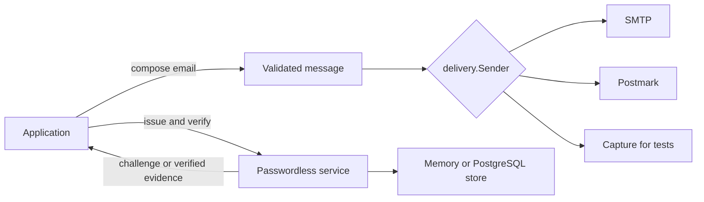

# Correio

[](https://github.com/gleam-dream/correio/actions/workflows/ci.yml)
[](https://hex.pm/packages/correio)
[](https://gleam.run/)

Correio provides transactional email and independent passwordless challenge verification for Gleam applications on Erlang. Applications own templates, accounts, permission decisions, browser policy, and sessions. Delivery and challenge verification remain separate; the application connects them explicitly. It requires Gleam 1.18 or later.

## When to use it

- Send transactional email through an injected sender, with SMTP or the optional Postmark adapter.
- Add magic-link or email-code verification to an existing application while keeping its account and session model.
- Test the application's real email flow without a provider, or inspect captured mail in a development-only inbox.

Correio is a fit for application-owned email and verification flows. It does not provide an outbox, delivery scheduler, bounce processing, inbound mail, account management, or an authentication server.

## Capabilities

- Typed address and message values with text or HTML bodies, attachments, recipient roles, headers, and a separate delivery envelope.
- MIME rendering and message admission before sending.
- Bounded SMTP submission with STARTTLS or implicit TLS, and an optional Postmark adapter.
- A common `delivery.Sender` function and distinct `Accepted`, `NotSent`, `Rejected`, and `OutcomeUnknown` results.
- Bounded capture with checkpoints and timed matching helpers for testing application email flows.
- An optional read-only HTTP handler for inspecting a capture in a development environment.
- Magic-link and email-code challenges bound to an application subject, purpose, scope, and destination.
- Opaque verification evidence and recovery handles for uncertain challenge operations.
- In-memory challenge storage or an optional PostgreSQL adapter over a caller-owned pool.

## Install

Add Correio from Hex:

```sh
gleam add correio
```

Commit `gleam.toml` and `manifest.toml` so builds use the same resolved versions.
The optional [mailbox](adapters/correio_mailbox/README.md),
[PostgreSQL](adapters/correio_postgres/README.md), and
[Postmark](adapters/correio_postmark/README.md) adapters install from Git subdirectories.

## How it fits

`Message`, injected `delivery.Sender`, and `passwordless.Service(a)` over a `Store(a)` are the main contracts. Capture and in-memory state run in explicitly owned, bounded OTP processes; PostgreSQL borrows the application's named pool. The application chooses when to send a challenge and what to do after verification.



`Message` construction does not send mail. This shortened excerpt makes a text and HTML alternative; the complete example adds Cc/Bcc, an inline attachment, a custom header, and an envelope sender. The [complete message example](apps/passwordless_demo/src/usage/compose_message.gleam)
supplies imports from `correio/address`, `correio/message` and `gleam/result`.

Both snippets below come from example modules that the repository gate runs.

<!-- prettier-ignore-start -->

<!-- snips: apps/passwordless_demo/src/usage/compose_message.gleam#compose-message -->
```gleam
// Parse addresses with ordinary `Result` handling. A display name is optional.
let assert Ok(from) =
  address.parse("hello@example.com")
  |> result.try(address.named(_, "Correio Store"))
let assert Ok(to) = address.parse("reader@example.com")
let assert Ok(copy) = address.parse("copy@example.com")
let assert Ok(audit) = address.parse("audit@example.com")
let assert Ok(support) = address.parse("support@example.com")
let assert Ok(bounce) = address.parse("bounces@example.com")

let assert Ok(mail) =
  message.new(
    from,
    to,
    "Your order",
    message.Alternative(
      "Your order is ready.",
      "<p>Your order is ready.</p>",
    ),
  )
```

<!-- prettier-ignore-end -->

An injected sender keeps application code independent of its transport. The
[capture example](apps/passwordless_demo/src/usage/capture_flow.gleam) supplies
the `capture`, `delivery` and `testing` imports and lets a test inspect the
message produced by the same application flow.

<!-- prettier-ignore-start -->

<!-- snips: apps/passwordless_demo/src/usage/capture_flow.gleam#capture-flow -->
```gleam
let assert Ok(recipient) = address.parse("reader@example.com")
let assert Ok(other) = address.parse("someone-else@example.com")

// Give each test its own capture so parallel tests cannot see each other.
let assert Ok(outbox) = capture.start(100)
let sender = capture.sender(outbox)

// Mail sent before the checkpoint can never satisfy the helper.
let assert delivery.Accepted(_) = welcome(sender, other)
let assert Ok(checkpoint) = capture.checkpoint(outbox)

let assert delivery.Accepted(_) = welcome(sender, recipient)
let assert Ok(mail) =
  testing.await(checkpoint, matching: testing.to(recipient), timeout_ms: 1000)
assert message.view(mail).subject == "Welcome"
assert message.view(mail).body
  == message.Text("Open https://app.example.test/start to begin.")

// Awaiting mail that never arrives is a bounded, typed failure.
assert testing.await(checkpoint, matching: testing.to(other), timeout_ms: 50)
  == Error(testing.TimedOut)
assert testing.await(checkpoint, matching: testing.to(other), timeout_ms: -1)
  == Error(testing.InvalidTimeout)

// Inspection never consumes: since() returns the post-checkpoint messages.
let assert Ok(after) = capture.since(checkpoint)
assert after != []
let assert Ok(Nil) = capture.stop(outbox)
```

<!-- prettier-ignore-end -->

The `welcome` function in the [runnable example](apps/passwordless_demo/src/usage/capture_flow.gleam) is application code that accepts a `delivery.Sender` and constructs its message.

## Passwordless verification

The application supplies a stable secret of 32–4096 cryptographically random bytes across restarts and a store for its native subject type. `passwordless.issue` returns a challenge and answer; it does not send email. The application delivers the answer, verifies it with the current trusted destination, applies its own account policy, and publishes its own session. See the [memory example](apps/passwordless_demo/src/usage/passwordless_memory.gleam) for issue, verify, refusal, revocation, and recovery, or the [PostgreSQL example](apps/passwordless_demo/src/usage/passwordless_postgres.gleam) for explicit migration and cleanup.

## Packages and examples

- [`correio_postmark`](adapters/correio_postmark) submits through Postmark. Its [usage test](adapters/correio_postmark/test/usage_test.gleam) uses a local scripted peer and dummy token.
- [`correio_postgres`](adapters/correio_postgres) provides durable challenge storage through a caller-owned named Pog pool.
- [`correio_mailbox`](adapters/correio_mailbox) reads captured messages; the application owns the HTTP server and access control.
- [`passwordless_demo`](apps/passwordless_demo) is a local browser example, not a production authentication application.
- [Runnable usage examples](apps/passwordless_demo/src/usage) cover delivery outcomes, capture, the development mailbox, and passwordless verification.

For Postmark, add token redaction before starting the caller-owned HTTP client. Recordings also retain message bodies and addresses unless you enable body redaction; see the [adapter README](adapters/correio_postmark/README.md) for details.

## Important behavior

- `Accepted` means the provider accepted the submission; it does not confirm inbox delivery. `OutcomeUnknown` means submission may have occurred, so do not retry it automatically.
- Captured messages can contain login links, codes, addresses, and blind recipients. Mount the mailbox only in development and put it behind application access control.
- Memory storage is bounded and disappears on restart. The PostgreSQL adapter requires explicit migration and cleanup; the application owns the pool.
- Keep a challenge operation's recovery handle when its outcome is unknown and resolve that operation through `recover_issue`, `recover_verify`, or `recover_revoke`.

## Development

Run the repository gate with a local scripted SMTP/HTTP peer and disposable PostgreSQL:

```sh
nix develop -c scripts/check
```

The [design](docs/design/design-layer.pdf) defines contracts and ownership. [Benchmarks](docs/BENCHMARKS.md) are historical single-host observations without performance thresholds.

Code is licensed under [Apache 2.0](LICENSE).
